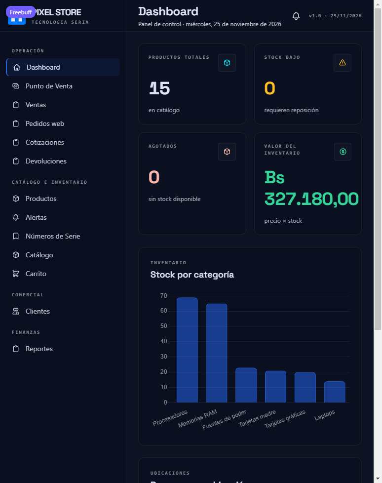
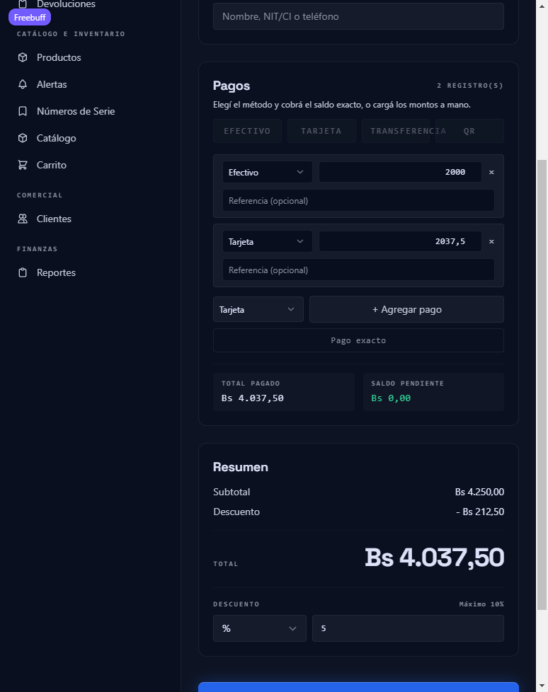
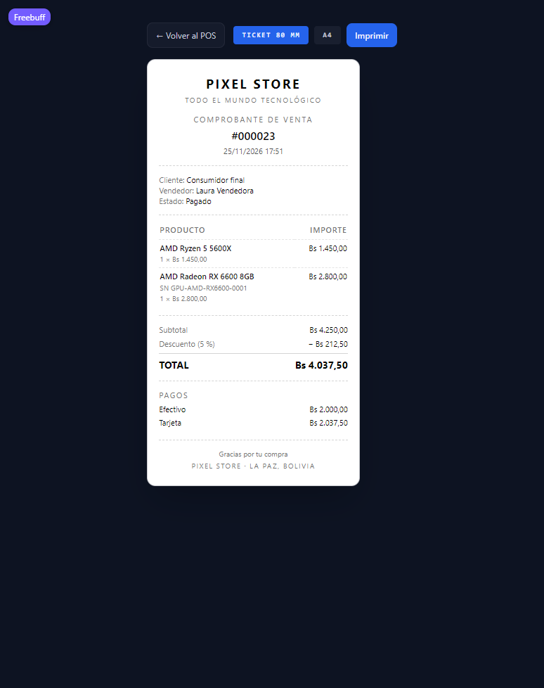
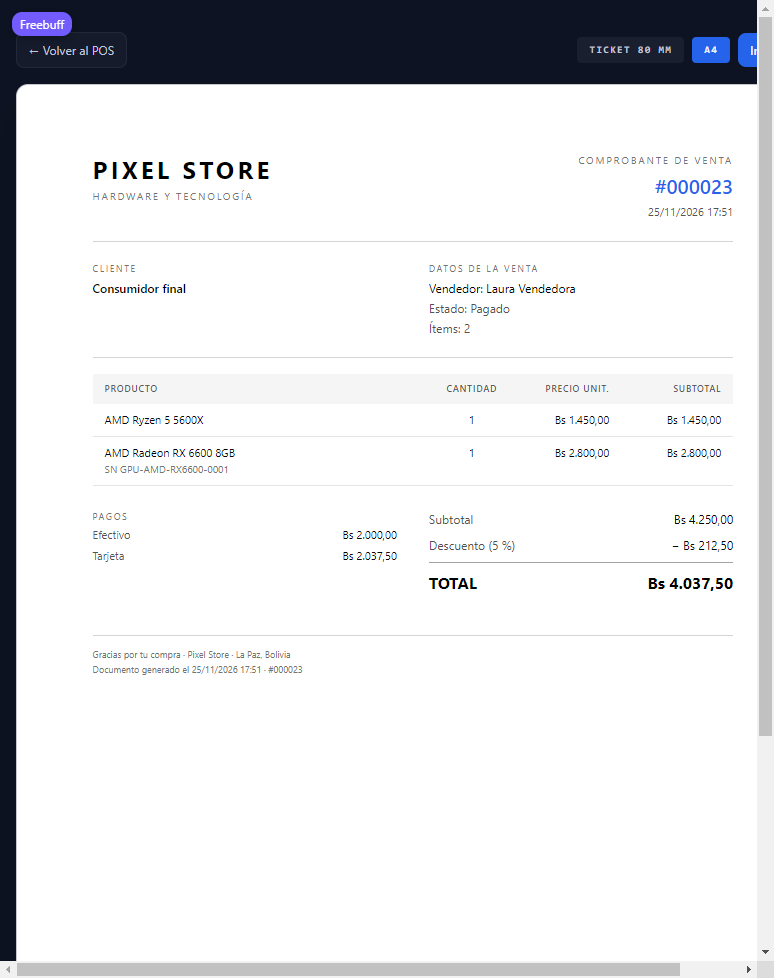
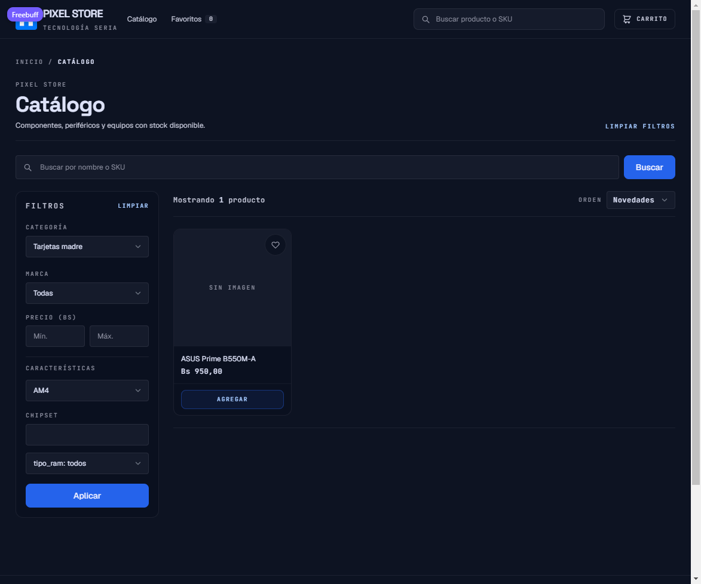
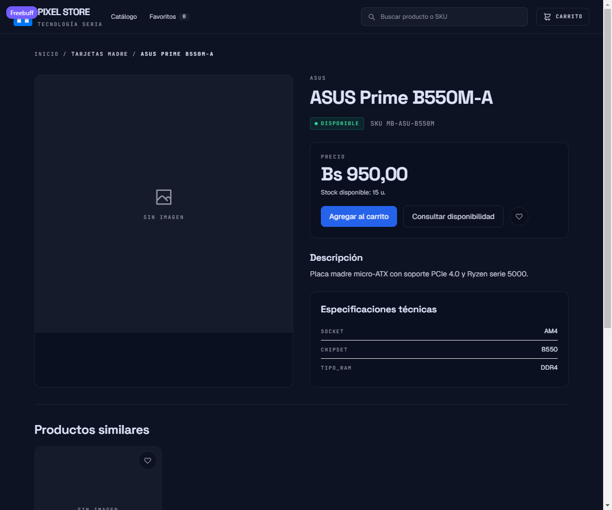

# 10 — Manual de usuario — Pixel Store

**Versión**: 1.0 · **Fecha**: 2026-11-25
**Alcance**: Punto de Venta (POS), catálogo público, inventario, comprobantes, devoluciones y cierre de caja.
**Audiencia**: vendedores, cajeros, encargados de inventario y administradores de Pixel Store.

> **Nota de numeración**: este archivo comparte el prefijo `10` con
> [`10-qa-final-sprint2.md`](10-qa-final-sprint2.md), igual que `09-roadmap.md` y
> `09-hu-pos.md` comparten el `09`. El índice reservaba el **10** para el manual.

Este manual describe **lo que la aplicación hace hoy**, con los nombres exactos de
botones, campos y mensajes. Cuando una función depende de un tercero (facturación
electrónica, WhatsApp, pasarela de pago) se dice explícitamente y se enlaza la
decisión en [`17 — Alcance externo`](17-alcance-externo.md).

---

## Índice

1. [Entrar al sistema](#1-entrar-al-sistema)
2. [La interfaz Obsidian](#2-la-interfaz-obsidian)
3. [Dashboard](#3-dashboard)
4. [Punto de Venta en tres pasos](#4-punto-de-venta-en-tres-pasos)
5. [Comprobantes: ticket de 80 mm y A4](#5-comprobantes-ticket-de-80-mm-y-a4)
6. [Ventas, anulación y devoluciones](#6-ventas-anulación-y-devoluciones)
7. [Cierre de caja](#7-cierre-de-caja)
8. [Catálogo público](#8-catálogo-público)
9. [Inventario](#9-inventario)
10. [Problemas frecuentes](#10-problemas-frecuentes)
11. [Lo que este manual no cubre](#11-lo-que-este-manual-no-cubre)

---

## 1. Entrar al sistema

1. Abrir la aplicación en el navegador (`http://127.0.0.1:8000` en el entorno local;
   la URL de producción la entrega el administrador).
2. Escribir **correo** y **contraseña** en la pantalla de acceso.
3. El sistema redirige según el rol:

| Rol | Aterriza en |
|---|---|
| **Admin** | `/dashboard` |
| **Vendedor** | `/dashboard` |
| **Cajero** | `/dashboard` |
| **Inventario** | `/admin/inventario` (su módulo) |
| **Cliente** | `/dashboard` (solo catálogo y sus cotizaciones) |

**Sesión**: la barra superior muestra la versión y la fecha (`v1.0 · dd/mm/aaaa`).
El bloque inferior del sidebar muestra el usuario y su rol, con el enlace
**Cerrar sesión**. Una cuenta desactivada no puede iniciar sesión: el login
rechaza el intento aunque la contraseña sea correcta.

Las cuentas de demostración están en
[`04 — Roles y permisos`](04-roles-permisos.md#-usuarios-demo); este manual no
reproduce contraseñas.

---

## 2. La interfaz Obsidian

Pixel Store usa el sistema visual **Obsidian Cyber Grid** en el panel y en el
catálogo público. No es decoración: cada color y cada tipografía tiene un rol, y
saber leerlos acelera el trabajo diario.

### 2.1 Paleta

| Rol | Color | Dónde se ve |
|---|---|---|
| Fondo del panel | `#0a0e14` (`bg-surface`) | Toda la aplicación |
| Superficie de tarjetas | `bg-surface-container-lowest` con desenfoque | KPIs, tablas, modales |
| Superficie de campos | `bg-surface-container-low` | Inputs, selects, badges neutros |
| Acción principal | `#2563eb` (`bg-primary-container`) | Botón **Confirmar venta**, **Aplicar**, **Buscar** |
| Enlace / hover | `#a4c9ff` (`text-secondary`) | Enlaces de tablas, acciones |
| Señal en vivo | `#00dbe9` (`text-tertiary`) | Punto del contador de ítems, indicadores activos |
| Éxito | `emerald-400` | **Pagado**, saldo cubierto, **Disponible** |
| Advertencia | `amber-400` | **Stock bajo**, descuento sin autorizar, **Últimas unidades** |
| Error | `text-error` (rojo) | **Agotado**, stock insuficiente, campos inválidos |

> **Regla de lectura**: si un número está en ámbar, requiere atención; si está en
> rojo, bloquea una operación; si está en verde, está resuelto.

### 2.2 Tipografía

| Familia | Uso | Ejemplo |
|---|---|---|
| **Space Grotesk** | Títulos y cifras grandes | `Nueva venta`, `Bs 4.037,50` |
| **Geist** | Texto, formularios y tablas | Nombres de producto, mensajes |
| **JetBrains Mono** | Etiquetas, SKU y códigos | `TOTAL`, `SKU MB-ASU-B550M`, `#000023` |

Las etiquetas en mayúsculas con espaciado amplio (`POS · VENTA`, `TOTAL PAGADO`)
son etiquetas de mono: describen el dato que tienen debajo. Los importes siempre
van en formato boliviano (`Bs 4.037,50`) y las cantidades con separador de miles.

### 2.3 Estructura de la pantalla

- **Sidebar** (izquierda): grupos **Operación**, **Catálogo e inventario**,
  **Comercial**, **Finanzas** y **Administración**. Cada enlace aparece solo si el
  rol tiene el permiso correspondiente; si no ves un módulo, no es un error: tu
  rol no lo incluye.
- **Cabecera**: título de la página, subtítulo y campana de alertas con el número
  de alertas sin leer.
- **Contenido**: tarjetas con borde hairline y fondo glass.
- **Pie**: versión de Laravel y motor de base de datos (diagnóstico).

---

## 3. Dashboard

El dashboard resume el estado del negocio en cuatro indicadores y dos bloques:

| Bloque | Qué muestra |
|---|---|
| **Productos totales** | Productos en catálogo (`en catálogo`) |
| **Stock bajo** | Productos en o bajo su umbral (`requieren reposición`) |
| **Agotados** | Productos sin stock (`sin stock disponible`) |
| **Valor del inventario** | Precio × stock, en bolivianos (`precio × stock`) |
| **Stock por categoría** | Gráfico de barras con el stock sumado por categoría |
| **Resumen por ubicación** | Stock total por tienda/almacén, con su tipo |
| **Productos críticos** | Tabla con producto, SKU, categoría, stock, umbral y enlace **Reponer** |

El dashboard se calcula al abrir la página. Para seguimiento continuo del
inventario, usar `/admin/inventario`, que refresca sus indicadores cada 30 s
(ver §9).

---

## 4. Punto de Venta en tres pasos

**Entrada**: sidebar → **Punto de Venta** (`/admin/ventas/nueva`).
**Permiso**: el enlace aparece en el sidebar con `crear ventas`, que también es el
permiso que exige confirmar la venta.

La pantalla se organiza como un flujo de tres pasos, siempre visibles en la barra
superior:

| Paso | Nombre | Subtítulo dinámico |
|:-:|---|---|
| 1 | **Buscar** | `Agregar productos` |
| 2 | **Carrito** | `Sin ítems` / `N línea(s)` |
| 3 | **Cobrar** | `Sin pagos` / `Bs X registrado` |

Arriba a la derecha se ve el contador de ítems (con punto cian) y el total actual.
No se puede saltar al paso 3 sin ítems: el sistema muestra un aviso y bloquea el
salto.

### 4.1 Paso 1 — Buscar y agregar

1. Escribir en **Buscar producto** (nombre, SKU o código de barras). La búsqueda
   se ejecuta sola a los 300 ms y devuelve hasta 10 resultados.
2. Cada resultado muestra nombre, precio, stock y si **maneja número de serie**.
3. Pulsar el resultado para agregarlo al carrito. Se puede repetir para varios
   productos.
4. Pulsar **Cobrar** para pasar al carrito.

**Límite de stock**: el carrito no deja superar el stock real del producto. Si se
intenta, aparece un aviso ámbar y la cantidad vuelve al máximo permitido.

### 4.2 Paso 2 — Carrito

Tabla con **Producto**, **Precio**, **Cantidad**, **Subtotal** y la acción
**Quitar**.

- Cambiar la cantidad con **−** / **+** o escribiéndola en el campo central.
- Si el producto maneja serie, debajo del nombre aparece **Elegir serie**; al
  elegirla se muestra el código (`GPU-AMD-RX6600-0001`) con una **×** para
  quitarlo.
- **Seguir agregando** vuelve al paso 1.
- **Continuar al pago** avanza al paso 3.

#### Elegir número de serie

El modal **Elegir serie** lista solo las series en estado `disponible` del
producto. Al elegir una, el POS la revalida contra el servidor antes de aceptarla
(evita vender una serie que otro usuario acaba de tomar).

| Situación | Qué muestra |
|---|---|
| Hay series | Lista de códigos, uno por botón |
| No hay series | **Este producto no tiene series disponibles.** |
| Serie tomada por otro | Mensaje de error y la lista se recarga |

Sin serie elegida no se puede confirmar la venta: el botón queda deshabilitado y
aparece **Elegí la serie de los productos marcados con 'Requiere serie'.**

### 4.3 Paso 3 — Cobrar

Tres bloques: **Cliente**, **Pagos** y, a la derecha, **Resumen** + confirmación.

#### Cliente (opcional)

- Buscar por **nombre, NIT/CI o teléfono**. Al elegir un resultado, el cliente
  queda fijado en la venta (`Cliente: Nombre`) con una **×** para quitarlo.
- **Cliente rápido** (solo si el rol tiene `crear clientes`) abre un formulario
  para crear el cliente sin salir del POS.
- Sin cliente, la venta se registra como **Consumidor final**.

#### Pagos

Fila de atajos: **Efectivo**, **Tarjeta**, **Transferencia**, **QR**. Cada atajo
registra el **saldo exacto** con ese método. Para importes distintos:

1. Elegir método en el selector y pulsar **+ Agregar pago**.
2. Escribir el **monto** y, si hace falta, la **Referencia** (número de voucher,
   transferencia, etc.).
3. Repetir para pago mixto.
4. **Pago exacto** completa el saldo con el método seleccionado.

Debajo se ven **Total pagado** y **Saldo pendiente**. El saldo se pone en verde al
llegar a cero y en ámbar mientras falte dinero. Se acepta pagar de más (vuelto en
efectivo); el servidor rechaza la venta si la suma de pagos no cubre el total.

#### Descuento

- Tipo **%** o **Bs** y el valor. El recálculo del total y del saldo es inmediato.
- A la derecha de la etiqueta se muestra el **máximo del rol**:

| Rol | Descuento máximo |
|---|:-:|
| Admin | 100 % |
| Vendedor | 10 % |
| Cajero | 5 % |
| Inventario / Cliente | 0 % |

- Si el valor supera el máximo, el descuento **no se aplica**, el total vuelve al
  original y aparece **Descuento requiere autorización de administrador.** con el
  botón **Solicitar autorización**.
- **Solicitar autorización** abre el modal de credenciales de un administrador. Al
  aprobarse, el aviso pasa a verde: *Descuento autorizado por … Autorización
  registrada.*

#### Confirmar

**Confirmar venta** se habilita solo cuando hay al menos un pago, el saldo es cero
y todas las líneas serializadas tienen serie. Mientras tanto explica el motivo
(`Continuar al pago requiere registrar al menos un pago.`, `faltan series`,
`falta pago`).

Al confirmar:

1. El servidor recalcula precios, descuento y total con los datos de la base, bajo
   bloqueo de stock.
2. Se crea la venta, sus pagos y su ingreso económico en una sola transacción.
3. Aparece la tarjeta verde **Venta confirmada** con **Venta #N**, **Total
   cobrado** y el enlace **Ver comprobante**.

**Reintentos**: el POS envía una clave de operación; si se pulsa dos veces o se
reintenta por un corte de red, la venta no se duplica.

### 4.4 Errores del POS y qué hacer

| Mensaje / situación | Causa | Solución |
|---|---|---|
| **Stock insuficiente** | Otro usuario vendió las últimas unidades | Actualizar la búsqueda y ajustar la cantidad |
| **Serie no disponible** | La serie fue vendida o reservada | Elegir otra serie |
| **Pago insuficiente** | La suma de pagos no cubre el total | Agregar o corregir un pago |
| **Descuento requiere autorización** | Supera el máximo del rol | Bajar el descuento o pedir autorización |
| **Este producto no tiene series disponibles** | No hay series cargadas para ese producto | Cargarlas en **Números de Serie** (§9.4) |
| **Confirmar venta** deshabilitado | Falta pago o falta serie | Revisar los avisos bajo el botón |

---

## 5. Comprobantes: ticket de 80 mm y A4

Desde la venta confirmada (**Ver comprobante**) o desde el detalle de la venta
(**Ticket** / **A4**) se abre el comprobante, con tres acciones en la barra
superior: **Volver al POS**, **Ticket 80 mm**, **A4** e **Imprimir**.

### 5.1 Ticket de 80 mm

- Hoja configurada para impresora térmica: `@page size: 80mm auto`, margen de
  4 mm.
- Encabezado **PIXEL STORE · TODO EL MUNDO TECNOLÓGICO**, **COMPROBANTE DE VENTA**,
  número `#000023` y fecha/hora.
- Cliente, vendedor y estado.
- Líneas con cantidad, precio, subtotal y **SN** cuando el producto maneja serie.
- **Subtotal**, **Descuento (5 %)** y **TOTAL** destacado.
- **PAGOS** por método y el pie *Gracias por tu compra · Pixel Store · La Paz,
  Bolivia*.

### 5.2 Hoja A4

- `@page size: A4`, margen de 20 mm, maquetación de hoja completa.
- Tabla con **Cantidad**, **Precio unit.** y **Subtotal**, y el bloque de totales a
  la derecha.
- Pie con la leyenda *Documento generado el dd/mm/aaaa hh:mm · #000023*.

> **Importante**: este comprobante **no es una factura fiscal**. La factura
> electrónica se emite desde **Facturación**, que hoy funciona en modo simulación
> porque el SIN (CUCU/Libélula) todavía no entregó credenciales
> ([`17` §1](17-alcance-externo.md)). El comprobante sirve para entregar al cliente
> y para el control interno.

---

## 6. Ventas, anulación y devoluciones

**Entrada**: sidebar → **Ventas** (`/admin/ventas`).

- El listado muestra las ventas del POS y de la web, con estado, fecha, cliente,
  vendedor y total.
- Al abrir una venta se ven cabecera, **Productos** (con SN), **Pagos**,
  **Devoluciones** y las acciones **Ticket**, **A4**, **Devolver** y **Anular
  Venta** (esta última solo para Admin).

### 6.1 Devolución

1. Abrir la venta y pulsar **Devolver**.
2. Marcar las líneas a devolver y ajustar la cantidad (el máximo es lo pendiente
   de esa línea).
3. Escribir el **Motivo**.
4. Opcional: **Requiere aprobación (queda pendiente, sin mover stock)**.
5. **Registrar devolución**.

| Tipo | Efecto inmediato |
|---|---|
| Directa | Reingresa stock, libera la serie y revierte puntos |
| Con aprobación | Queda `pendiente`; no mueve stock hasta que un Admin la apruebe en **Devoluciones** |

La venta pasa a **Parcialmente devuelta** o **Totalmente devuelta** según lo
devuelto. Una devolución aprobada o procesada deja la serie en `disponible` y
desliga la venta.

### 6.2 Anulación

**Anular Venta** (solo Admin) pide confirmación, reingresa el stock y deja la venta
en **Cancelada**. No se puede anular una venta ya devuelta por completo.

---

## 7. Cierre de caja

**Entrada**: sidebar → **Caja** (visible para Admin y Cajero).

1. Elegir el **Día** y pulsar **Ver día**.
2. Revisar los tres indicadores: **Cobrado en el día**, **Efectivo esperado**
   (menos devoluciones) y **Diferencia acumulada** (`efectivo real − esperado`).
3. Ver el desglose **Montos del sistema** por método (Efectivo, Tarjeta,
   Transferencia, QR, Otro).
4. Pulsar **Nuevo cierre**: elegir **Fecha**, **Turno** y (si eres Admin) el
   **Vendedor**; pulsar **Recalcular montos**; escribir el **Real** de cada método
   (solo aparecen los que tuvieron movimientos), revisar la **Diferencia de
   efectivo** en vivo, agregar **Notas** y pulsar **Registrar cierre**.
5. **Cierres del día** lista turno, vendedor, esperado, real, diferencia (verde si
   es cero, rojo si no), notas y el comprobante PDF.
6. **Reporte diario** abre el resumen del día en pantalla y su PDF.

El vuelto no se guarda en cada venta: se calcula en el cierre como
`efectivo real − efectivo esperado`. Si el cajero pagó de más en una venta, la
diferencia aparece acá.

---

## 8. Catálogo público

**Entrada**: `/catalogo` (sidebar → **Catálogo**, o la navegación pública).
No requiere sesión.

### 8.1 Buscar y filtrar

- **Buscador**: por nombre o SKU. Tolera errores de tipeo y tildes (por ejemplo
  `ryzen` encuentra `Ryzen`, y una palabra incompleta sigue encontrando el
  producto); el SKU siempre se compara exacto.
- **Filtros** (columna izquierda):
  - **Categoría** y **Marca** (`Todas` por defecto).
  - **Precio (Bs)**: **Mín.** y **Máx.**
  - **Características**: un control por atributo técnico disponible (`SOCKET`,
    `CHIPSET`, `TIPO RAM`, …). Los atributos con valores predefinidos son listas
    (`AM4`, `tipo_ram: todos`); los numéricos o libres son campos de texto.
  - **Aplicar** ejecuta; **Limpiar** (o **Limpiar filtros**, arriba a la derecha)
    borra todo.
- **Orden**: `Novedades`, `Menor precio`, `Mayor precio`, `Nombre A–Z`,
  `Nombre Z–A`.
- Arriba de los resultados: **Mostrando N productos** y la página actual.

Si no hay coincidencias: *No encontramos productos con esos filtros* con el enlace
**Ver todo el catálogo**.

### 8.2 Tarjetas de producto

Cada tarjeta muestra imagen (o **Sin imagen**), nombre, precio, el botón de
favorito (corazón) y:

- **Agregar** si hay stock → cambia a **Agregado** durante un segundo.
- **Sin stock** deshabilitado si no hay unidades.

### 8.3 Ficha de producto

- **Migas**: Inicio / Categoría / Producto.
- **Marca**, nombre, estado de stock y **SKU**.
- Estados: **Disponible** (verde), **Últimas unidades** (ámbar, cuando el stock es
  igual o menor al umbral), **Agotado** (rojo).
- **Precio** y **Stock disponible: N u.**
- **Agregar al carrito** (o **Agotado**), **Consultar disponibilidad** (abre el
  correo a ventas) y el corazón de favoritos.
- **Descripción** y **Especificaciones técnicas** con los atributos EAV cargados
  (SOCKET, CHIPSET, TIPO_RAM…). Si el producto no tiene atributos, el bloque no
  aparece.
- **Productos similares** y **Alternativas** de la misma categoría.

### 8.4 Carrito y checkout

1. **Carrito** (barra superior) abre el panel lateral con líneas, cantidades,
   **Quitar**, **Subtotal** e **Ir a pagar**.
2. En **Finalizar compra** se completan **Nombre completo**, **NIT / CI**,
   **Teléfono**, **Correo electrónico** y **Dirección de entrega**.
3. **Confirmar pedido** abre la página **Pedido #N recibido**: *Reservamos el stock
   y dejamos el pedido en estado Pendiente. Te contactamos al … para coordinar la
   entrega y el pago.* El pedido queda como venta **Pendiente**, **reserva stock**
   y aparece en **Pedidos web**.
4. El pago se coordina al recibir el pedido; desde **Pedidos web** el personal
   registra el pago o cancela el pedido (cancelar libera el stock reservado).

**Favoritos**: el corazón de cada tarjeta guarda el producto; **Favoritos** en la
navegación muestra la lista y el contador.

---

## 9. Inventario

**Entrada**: sidebar → **Inventario** (`/admin/inventario`).

> **Acceso exclusivo**: además de la sesión, exige el permiso `ver inventario`.
> Admin e Inventario entran; Vendedor, Cajero y Cliente reciben **403** y el
> intento queda auditado.

### 9.1 Indicadores

Los cuatro indicadores (**Productos totales**, **Stock bajo**, **Agotados**,
**Valor del inventario**) se refrescan **cada 30 segundos sin recargar** mientras
la página esté abierta. Si el stock cambia por otra vía (otra venta, otra
pestaña), el número se actualiza solo.

> El refresco automático cubre **los cuatro indicadores**. Las filas de la tabla
> de productos críticos no se refrescan solas: se actualizan al recargar. Es una
> decisión documentada, no un fallo.

### 9.2 Stock por categoría y por ubicación

- **Stock por categoría**: barras con la suma de unidades por categoría.
- **Resumen por ubicación**: total por tienda/almacén y su tipo. Si no hay
  ubicaciones con stock, muestra *No hay ubicaciones con stock registrado.*

### 9.3 Productos críticos

Tabla con **Producto**, **SKU**, **Categoría**, **Stock** (badge rojo), **Umbral** y
**Reponer**, que abre la edición del producto. Cuando todo está sano:
*Todo el inventario está saludable.*

Para cambiar la cantidad:

- **Editar producto** → campo de stock (ajuste con movimiento registrado).
- **Transferir stock** (detalle del producto): origen con stock, destino y
  cantidad. Útil para mover unidades entre tienda y almacén sin perder
  trazabilidad.

### 9.4 Números de serie

**Entrada**: sidebar → **Números de Serie** (`/admin/series`).

- Lista con **Serie**, **Producto** (y SKU), **Estado**, **Cliente**, **Garantía**
  y acciones **Ver** / **Editar**.
- Filtros: **Buscar** (serie, producto o SKU) y **Estado**.
- **+ Registrar Serie** crea series nuevas (permiso `editar numeros-serie`).

| Estado | Significado |
|---|---|
| `disponible` | En stock, se puede vender |
| `vendido` | Asignada a una venta |
| `reservado` | Apartada, no disponible para el POS |
| `devuelto` | Volvió por una devolución |
| `defectuoso` | No debe venderse (RMA) |

La **Garantía** es la fecha hasta la que el cliente tiene cobertura y se ve en la
columna correspondiente de esta lista.

### 9.5 Alertas de stock

**Entrada**: campana de la cabecera o sidebar → **Alertas**.

- Etiquetas **Sin stock** (rojo) y **Bajo stock** (ámbar); las no leídas llevan un
  punto cian y fondo resaltado.
- **Marcar todas como leídas**, **Marcar leída**, **Ver producto** y **Eliminar**
  (con confirmación).
- El número de la campana es la cantidad de alertas sin leer.

---

## 10. Problemas frecuentes

| Síntoma | Causa probable | Qué hacer |
|---|---|---|
| No veo un módulo en el sidebar | El rol no tiene el permiso | Pedir el permiso al Admin ([`04`](04-roles-permisos.md)) |
| **403** al abrir Inventario | Falta `ver inventario` | Entrar con Admin o con el usuario de Inventario |
| **Confirmar venta** no se habilita | Falta un pago, falta una serie o el saldo no es cero | Revisar los avisos bajo el botón y el **Saldo pendiente** |
| El descuento desaparece al escribir | Supera el máximo del rol | Bajar el porcentaje o **Solicitar autorización** |
| El modal de series está vacío | El producto no tiene series `disponible` | Cargarlas en **Números de Serie** |
| El indicador de inventario no cambia | Solo se refresca cada 30 s y solo los cuatro KPIs | Esperar un ciclo o recargar |
| Una tarjeta del catálogo dice **Sin imagen** | El producto no tiene imagen principal | Cargar la galería desde el producto |
| **Agotado** en la ficha pero hay stock en el panel | Diferencia entre stock publicado y reservas | Verificar stock y umbral del producto |
| La factura dice **simulación** | No hay proveedor SIN contratado | Es el comportamiento esperado ([`17`](17-alcance-externo.md)) |
| No se puede pagar en línea desde el catálogo | El checkout coordina pago contra entrega | Registrar el pago en **Pedidos web** |

---

## 11. Lo que este manual no cubre

- **Facturación fiscal real** (SIN/CUCU): bloqueada por credenciales del proveedor;
  hoy la pantalla advierte el modo simulación.
- **Notificaciones salientes por WhatsApp**: requieren cuenta Business y plantillas
  aprobadas; el aviso de pedidos va por correo.
- **Pasarela de pago en línea** (Stripe/PayPal/QR automático): el QR y la
  transferencia se registran como método de pago con referencia, no hay cobro
  automático.
- **Impresión física**: se verificó la regla de paginación (80 mm y A4) y el
  contenido renderizado, no el corte del papel ni una impresora concreta.
- **Móvil**: la validación manual se hizo en Chromium de escritorio.
- **Multi-sucursal y compatibilidad automática de componentes**: fases futuras del
  roadmap ([`09`](09-roadmap.md)).

---

## Referencias

- [`09 — POS (HU 5.5/5.6/5.8)`](09-hu-pos.md): contrato técnico del POS, endpoints y
  permisos.
- [`16 — Validación manual del POS`](16-validacion-manual-pos.md): evidencia de los
  cinco puntos probados y las capturas.
- [`04 — Roles y permisos`](04-roles-permisos.md): matriz completa.
- [`17 — Alcance externo`](17-alcance-externo.md): qué queda fuera y por qué.
- [`skills/frontend-design.md`](../skills/frontend-design.md): tokens y reglas de la
  identidad Obsidian.
